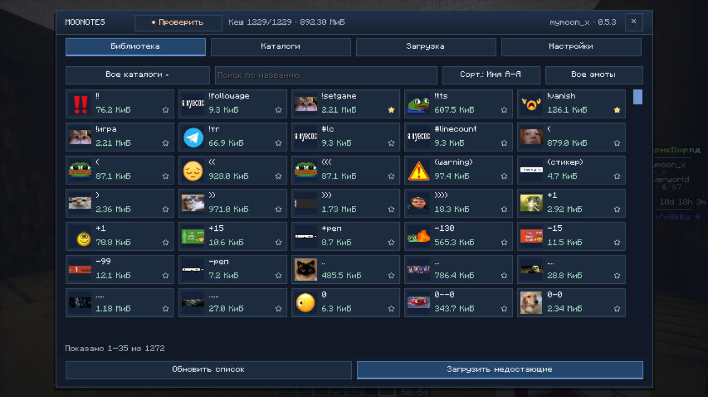
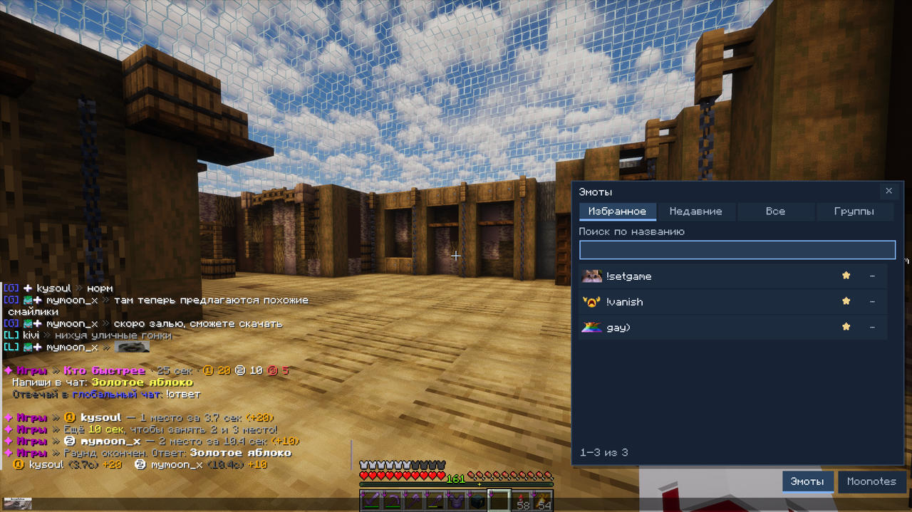

# 🌙 Moonotes

**Эмоты 7TV в Minecraft — библиотека, каталоги Twitch-каналов, избранное и быстрый выбор прямо в игровом чате.**

**Minecraft Java 26.3** · **Fabric** · **Java 25** · **Moonotes 0.5.3**

[📦 Скачать последнюю версию](https://github.com/mymoonx/moonotes/releases/latest) · [🖼 Все скриншоты](docs/SCREENSHOTS.md) · [🛠 Разработчикам](docs/DEVELOPMENT.md)

---

## С чего начать?

| 🎮 **Я хочу пользоваться модом** | 💻 **Я хочу работать с кодом** |
| --- | --- |
| Скачать готовые файлы, установить их и играть. Ничего собирать не нужно. | Исходники, сборка, тесты, архитектура и Cloudflare Worker. |
| **[Скачать Moonotes v0.5.3](https://github.com/mymoonx/moonotes/releases/tag/v0.5.3)** | **[Документация для разработчиков](docs/DEVELOPMENT.md)** |

## ✨ Возможности

- **Библиотека 7TV:** поиск, сортировка, фильтры и предпросмотр эмотов.
- **Каталоги:** несколько Twitch-каналов и наборов 7TV в одном интерфейсе.
- **Быстрый выбор в чате:** мини-библиотека, избранное, недавние и личные группы.
- **Подсказки при вводе:** выбор эмотов с помощью Tab и стрелок; вставка без автоматической отправки сообщения.
- **Загрузка и кеш:** скачивание недостающих изображений, общий кеш Streamotes и резервная загрузка через Cloudflare.
- **Настройки:** положение HUD, уведомления и локальная диагностика.

## 🖼 Как выглядит Moonotes

| Библиотека эмотов | Быстрый выбор в чате |
| :---: | :---: |
|  |  |
| Поиск, просмотр и избранное | Вставка названий эмотов прямо в чат |

**[Посмотреть все 8 скриншотов с описаниями →](docs/SCREENSHOTS.md)**

## 📦 Установка

> [!IMPORTANT]
> **Не удаляйте Streamotes!** Moonotes работает **вместе с оригинальным Streamotes**, а не вместо него. Для полного набора функций необходимо установить **оба JAR-файла Moonotes**.

**Нужны Minecraft Java 26.3, Fabric Loader 0.20.1+, совместимый Fabric API и Java 25.**

1. Установите или оставьте оригинальный **[Streamotes 1.2.16+26.3 (Fabric)](https://www.curseforge.com/minecraft/mc-mods/streamotes/files/9032701)**.
2. Скачайте **оба файла** из [релиза Moonotes v0.5.3](https://github.com/mymoonx/moonotes/releases/tag/v0.5.3):
   - [`moonotes-0.4.1.jar`](https://github.com/mymoonx/moonotes/releases/download/v0.5.3/moonotes-0.4.1.jar) — предпросмотр эмотов и каналы текущего мира.
   - [`moonotes-network-0.5.3.jar`](https://github.com/mymoonx/moonotes/releases/download/v0.5.3/moonotes-network-0.5.3.jar) — библиотека, каталоги, группы и загрузка.
3. Закройте Minecraft и поместите оба файла Moonotes в папку `mods` рядом со Streamotes и Fabric API.
4. Запустите игру. Откройте менеджер командой **`/moonotes`** или кнопкой «Moonotes» возле чата.

Разные номера версий двух JAR — **это нормально**. Cloudflare Worker отдельно устанавливать **не нужно**.

## ❓ Частые вопросы

**Можно установить только один JAR Moonotes?**  
Для всех описанных возможностей нужны оба. Отдельная установка одного из компонентов не заменяет полный комплект.

**Нужно ли заменять Streamotes?**  
Нет. Сохраните оригинальный Streamotes совместимой версии. Moonotes использует его отображение эмотов и общий кеш.

**Пропадут ли группы, избранное и кеш после обновления?**  
При замене JAR существующие пользовательские данные рассчитаны на сохранение. Удалять папки настроек и кеша не требуется.

**Как сообщить об ошибке?**  
Откройте [Issues](https://github.com/mymoonx/moonotes/issues) и укажите версии Minecraft/Fabric/модов, шаги воспроизведения и сообщение об ошибке. Не публикуйте токены или личные данные.

---

### 🛠 Для разработчиков

Исходники Moonotes, Moonotes Network и резервного Cloudflare Worker находятся в этом репозитории. Описание компонентов, команды сборки и тесты вынесены в **[отдельный раздел для разработчиков](docs/DEVELOPMENT.md)**.

[Изменения](CHANGELOG.md) · [Проверка сборок](docs/VERIFICATION.md) · [Сторонние компоненты](THIRD-PARTY-NOTICES.md)

**Автор Moonotes:** [mymoon_x](https://github.com/mymoonx) · **[Оригинальный Streamotes](https://modrinth.com/project/streamotes)** — отдельный проект.
