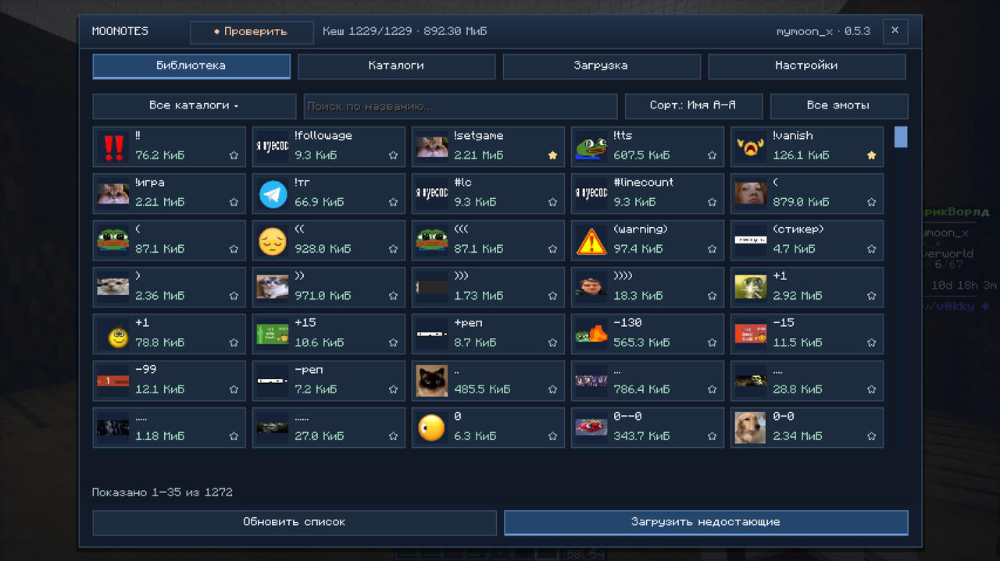
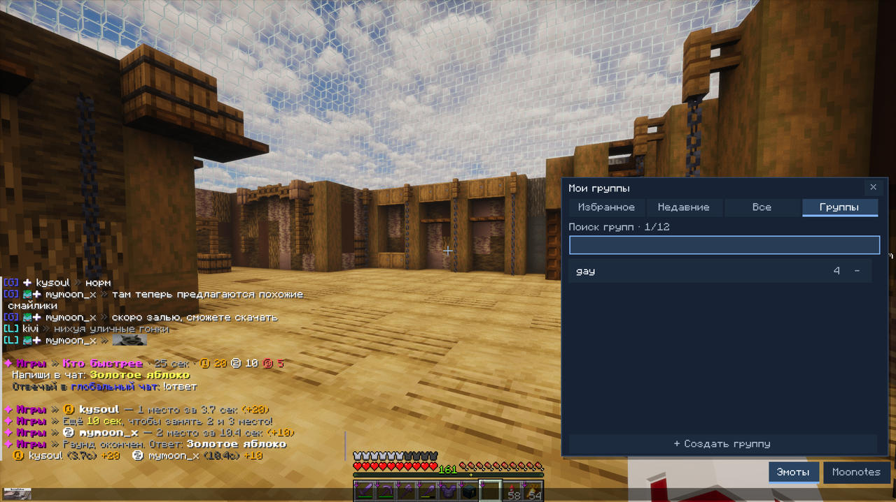
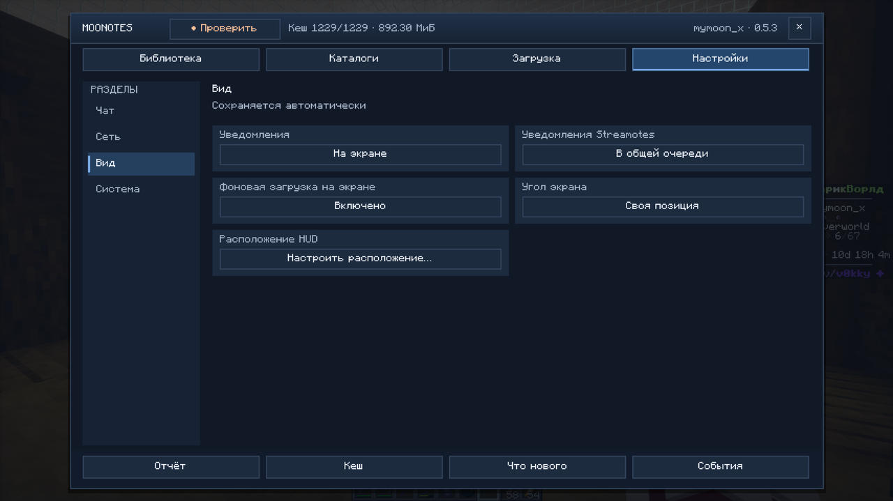

# Скриншоты Moonotes v0.5.3

Ниже — реальные скриншоты Minecraft Java 26.3 с установленными Moonotes и Moonotes Network. Интерфейс показан на русском языке.

## 1. Библиотека эмотов

Общая библиотека подключённых каталогов 7TV: поиск по названию, сортировка, фильтры, размеры кеша и добавление эмотов в избранное. Клик по карточке открывает предпросмотр.

## 2. Подключённые каталоги

Можно подключать несколько Twitch-каналов и наборов 7TV, обновлять списки и скачивать только отсутствующие изображения. Уже загруженные файлы используются повторно из общего кеша Streamotes.

## 3. Загрузка и проверка кеша

Прогресс скачивания, количество доступных изображений, сетевой источник и ошибки. В автоматическом режиме при недоступности 7TV используется резервный Cloudflare Worker.

## 4. Быстрый выбор эмотов в чате

Компактная мини-библиотека прямо в игровом чате: избранное, недавние, все эмоты и пользовательские группы. Нажатие вставляет название в текстовое поле **без отправки сообщения**.

## 5. Пользовательские группы

Собственные коллекции для часто используемых эмотов: создание групп, поиск и управление составом. Один эмот может находиться в нескольких группах.

## 6. Настройка положения HUD

Неброская шкала фоновой загрузки и уведомления могут располагаться в выбранной части экрана. Это удобно, если в игре уже есть HUD от других модов.

## 7. Настройки

Отдельные разделы для чата, сети, оформления и системных функций; настройка уведомлений, загрузки и локальной диагностики.

## 8. Автоподбор в игровом чате

Горизонтальная лента подходящих смайликов над полем ввода. Предложения берутся из подключённых каталогов, а названия подставляются в сообщение без автоматической отправки.

---

> **Примечание:** Moonotes и Moonotes Network — два самостоятельных клиентских дополнения к Streamotes. Сам оригинальный Streamotes не входит в эти архивы. Состояние сервисов 7TV и Cloudflare зависит от сети игрока.

[Вернуться к главному описанию](../README.md) · [Список изменений](../CHANGELOG.md)
