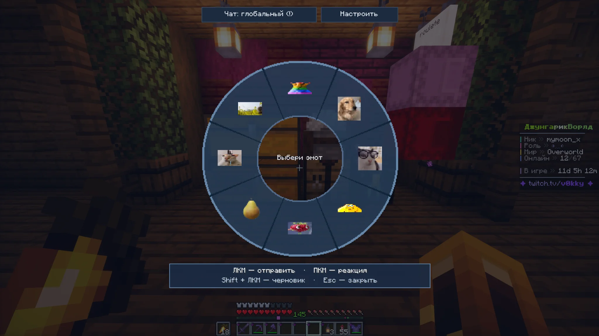
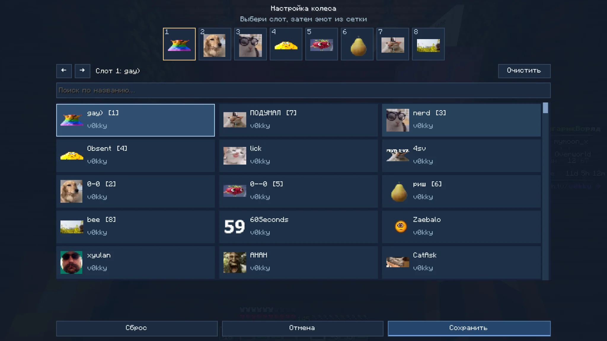
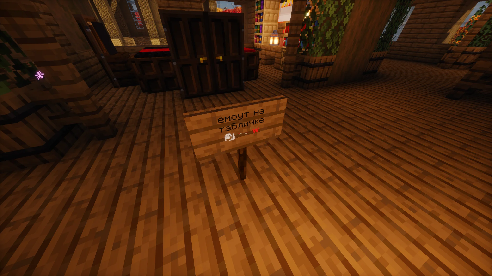
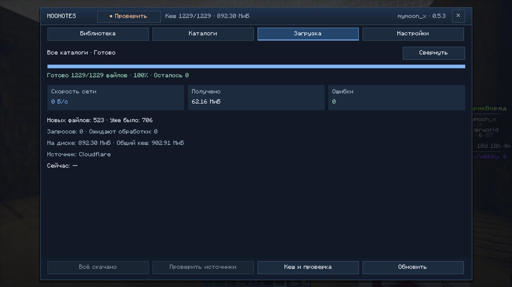
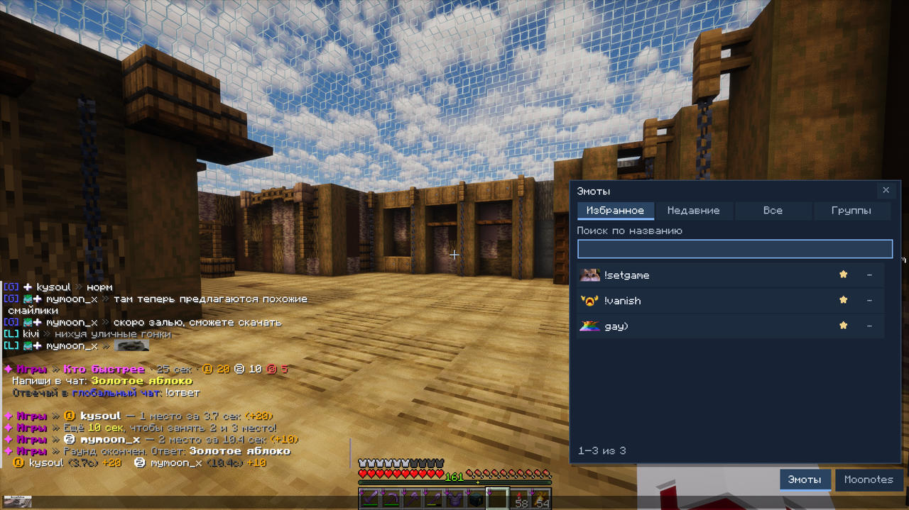

# 🖼 Галерея Moonotes

**11 скриншотов из Minecraft Java 26.3:** 8 основных и 3 новых из alpha.4. Нажмите на изображение, чтобы открыть его в полном размере.

[← Главная страница](../README.md) · [📦 Стабильная версия](https://github.com/mymoonx/moonotes/releases/latest) · [🌙 Alpha.4](https://github.com/mymoonx/moonotes/releases/tag/v0.6.0-alpha.4) · [🛠 Разработчикам](DEVELOPMENT.md)

---

## 🆕 Moonotes 0.6.0-alpha.4 — новые функции

Три игровых скриншота предварительной версии. [Скачать 0.6.0-alpha.4](https://github.com/mymoonx/moonotes/releases/tag/v0.6.0-alpha.4) · [Подробное описание изменений](https://github.com/mymoonx/moonotes/blob/feature/emote-wheel-world-reactions/docs/EXTRAS.md).

| **9. Колесо быстрых эмотов** | **10. Настройка колеса** |
| :---: | :---: |
|  |  |
| Клавиша G, восемь слотов, отправка ЛКМ и реакция ПКМ. Выбор локального или глобального чата. | Поиск, сохранение своих восьми эмотов, компактная сетка и перетаскиваемая прокрутка. |

**11. Эмоты на табличках**

Эмоты отображаются на обычных и подвесных табличках непосредственно в игровом мире; сохранённый текст не изменяется. Анимированные изображения используют кеш Streamotes.

*Скриншоты книги и реакции над персонажем будут добавлены отдельно.*

---

## Moonotes 0.5.3 — библиотека и каталоги

| **1. Библиотека эмотов** | **2. Подключённые каталоги** |
| :---: | :---: |
|  |  |
| Поиск, сортировка, фильтры, предпросмотр и избранное. | Несколько Twitch-каналов и наборов 7TV; обновление каталогов. |

| **3. Загрузка и кеш** | **4. Быстрый выбор в чате** |
| :---: | :---: |
|  |  |
| Прогресс, источник сети и загрузка отсутствующих изображений. | Избранное, недавние и группы — вставка названия без отправки сообщения. |

| **5. Пользовательские группы** | **6. Редактор HUD** |
| :---: | :---: |
|  |  |
| Создание собственных коллекций, поиск и изменение состава групп. | Размещение прогресса загрузки и уведомлений на экране. |

| **7. Настройки Moonotes** | **8. Автоподбор эмотов** |
| :---: | :---: |
|  |  |
| Разделы чата, сети, вида и системных функций. | Подсказки над строкой чата и выбор эмотов с клавиатуры. |

---

> **Для установки нужны оба JAR-файла Moonotes и оригинальный Streamotes.** Подробности — на [главной странице](../README.md#-установка).

[← Вернуться на главную](../README.md)
