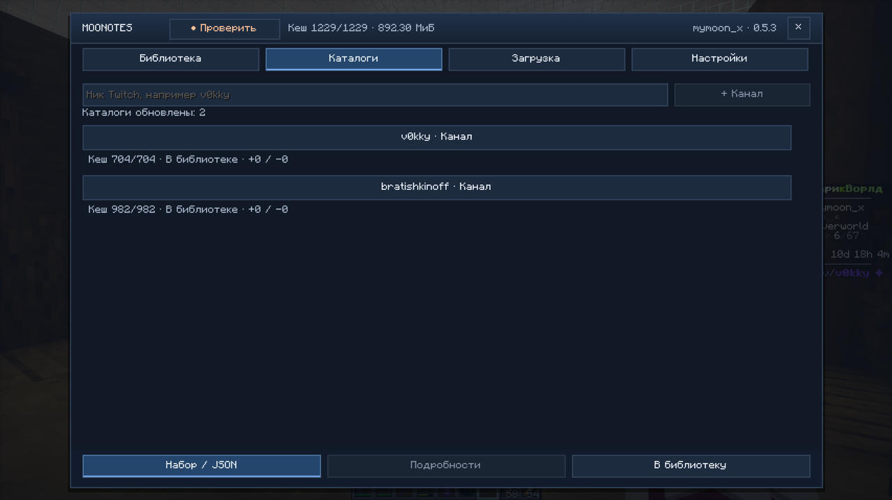
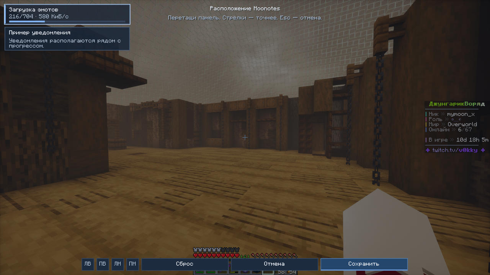
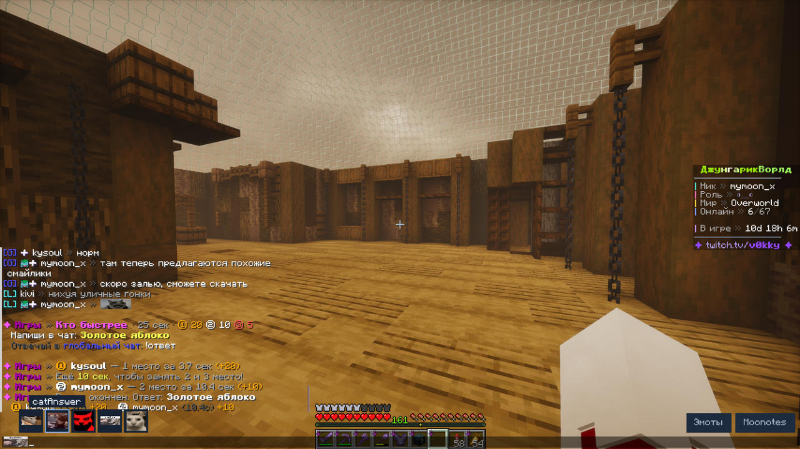

# 🖼 Галерея Moonotes

**8 скриншотов из Minecraft Java 26.3.** Нажмите на изображение, чтобы открыть его в полном размере.

[← Главная страница](../README.md) · [📦 Скачать Moonotes](https://github.com/mymoonx/moonotes/releases/latest) · [🛠 Разработчикам](DEVELOPMENT.md)

---

| **1. Библиотека эмотов** | **2. Подключённые каталоги** |
| :---: | :---: |
|  |  |
| Поиск, сортировка, фильтры, предпросмотр и избранное. | Несколько Twitch-каналов и наборов 7TV; обновление каталогов. |

| **3. Загрузка и кеш** | **4. Быстрый выбор в чате** |
| :---: | :---: |
|  |  |
| Прогресс, источник сети и загрузка отсутствующих изображений. | Избранное, недавние и группы — вставка названия без отправки сообщения. |

| **5. Пользовательские группы** | **6. Редактор HUD** |
| :---: | :---: |
|  |  |
| Создание собственных коллекций, поиск и изменение состава групп. | Размещение прогресса загрузки и уведомлений на экране. |

| **7. Настройки Moonotes** | **8. Автоподбор эмотов** |
| :---: | :---: |
|  |  |
| Разделы чата, сети, вида и системных функций. | Подсказки над строкой чата и выбор эмотов с клавиатуры. |

---

> **Для установки нужны оба JAR-файла Moonotes и оригинальный Streamotes.** Подробности — на [главной странице](../README.md#-установка).

[← Вернуться на главную](../README.md)
