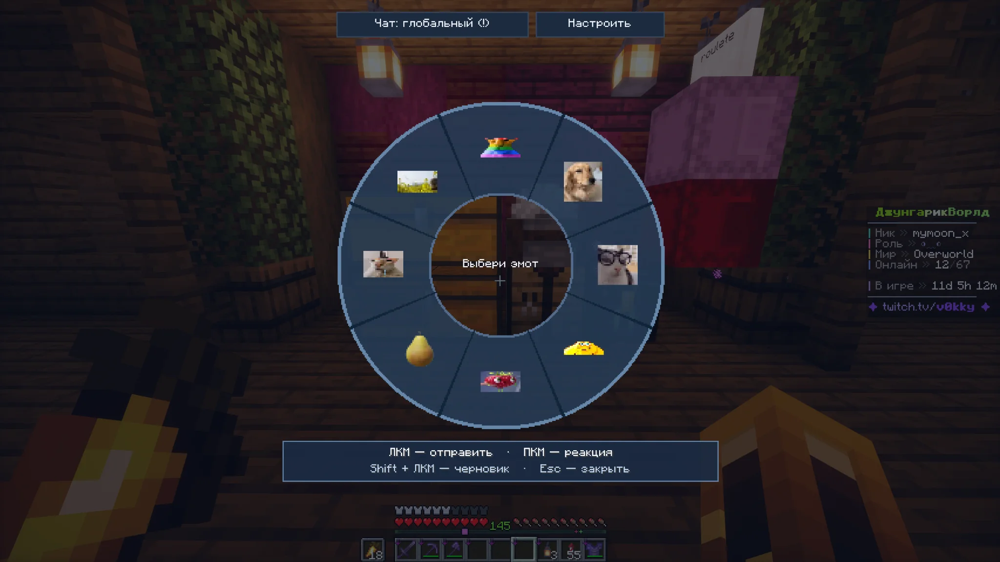
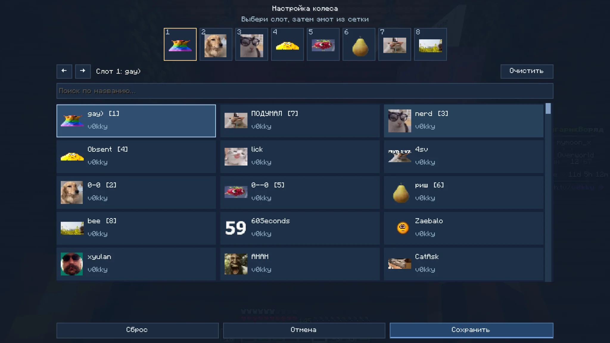
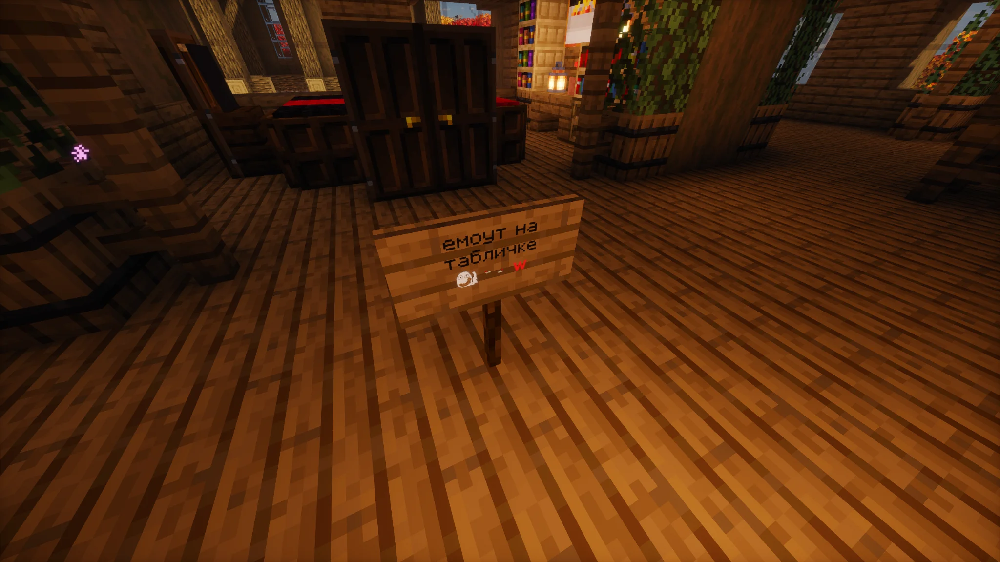

# Moonotes 0.6.0-alpha.4 — эмоты в мире и колесо реакций 🌙

**Minecraft Java 26.3 · Fabric · Java 25**

Это **предварительный релиз** Moonotes. Он расширяет Streamotes дополнительными возможностями для эмотов в Minecraft и основан на реальном игровом тестировании. Основной релиз 0.5.3 остаётся доступен.

> **Важно:** Streamotes **не удаляйте**. Для полной работы установите **оба JAR-файла Moonotes** из Assets ниже.

## 🖼 Скриншоты Moonotes 0.6.0-alpha.4

| Колесо быстрых эмотов | Настройка восьми слотов |
| :---: | :---: |
|  |  |
| Восемь слотов, выбор чата, мгновенная отправка и реакции. | Поиск, трёхколоночная сетка, перетаскиваемый ползунок. |

**Эмоты на табличках**

Эмоты отображаются непосредственно на табличках, сохраняя обычный текст. При наличии кадров в кеше Streamotes поддерживается анимация.

[Полная галерея: 11 скриншотов](https://github.com/mymoonx/moonotes/blob/main/docs/SCREENSHOTS.md). Изображения книги и реакции над персонажем добавим позднее.

## 📦 Установка

Потребуются оригинальный **Streamotes 1.2.16+26.3**, **Fabric Loader 0.20.1+**, совместимый **Fabric API** и **Java 25**.

1. Закройте Minecraft.
2. Оставьте Streamotes и Fabric API в папке `mods`.
3. Удалите из `mods` **старый JAR `moonotes-network-...`** — одновременно две версии Network ставить нельзя.
4. Скачайте и поместите в `mods`:
   - **`moonotes-0.4.1.jar`** — основной компонент (не изменился).
   - **`moonotes-network-0.6.0-alpha.4.jar`** — библиотека, каталоги, колесо и новые функции.
5. Запустите Minecraft и откройте менеджер командой `/moonotes`.

Cloudflare Worker отдельно устанавливать не нужно.

## ✨ Что нового

### Колесо быстрых эмотов

- Клавиша **G** (переназначается в настройках управления Minecraft).
- Восемь сохраняемых слотов: **«Настроить»** → поиск → назначение → перестановка → сохранение.
- Компактный редактор **до трёх колонок** с прокруткой колёсиком и **перетаскиваемым ползунком**.
- Название выбранного эмота — **внутри центра кольца**; подсказки — на отдельной контрастной панели.
- **ЛКМ** — сразу отправить эмот, **Shift + ЛКМ** — открыть черновик, **ПКМ** — показать реакцию.
- Переключатель чата: **локальный** (`42`) или **глобальный** (`!42`). Формат с двоеточиями Streamotes учитывается автоматически.

### Реакции рядом с персонажами

- Картинки из локального кеша видны рядом с персонажем, с масштабом по расстоянию до камеры.
- Дальность и время показа ограничены; реакция скрывается за препятствиями.
- При получении обычных сообщений с известными эмотами Moonotes может показывать локальные реакции рядом с отправителем.
- **Реакции — только клиентский визуальный эффект.** Они не рассылаются всем игрокам сервером.

### Эмоты в книгах и на табличках

- Изображения эмотов на обычных и подвесных табличках, включая обе стороны.
- Отображение при чтении книг, на кафедре и **при редактировании книги с пером**.
- **Анимация** в книгах и на табличках использует кадры и длительности из кеша Streamotes.
- Сохранённый текст, курсор и данные мира не меняются.
- Для неподдерживаемых или слишком больших анимаций доступен статичный первый кадр.
- По умолчанию функции отключены: включите их в **`/moonotes` → Настройки → Эмоты+**.

### Существующие функции сохранены

Библиотека 7TV, каталоги Twitch-каналов, избранное, группы, предпросмотр, чат-подсказки, кеш и резервная загрузка через Cloudflare.

**Twitch OAuth-привязки и Chatterino+ PLUS-пейнтов в этой версии нет** — экспериментальные функции не вошли в релиз.

## 🧪 Статус

Это предварительная сборка, предназначенная для проверки на Minecraft 26.3. Автоматические сборки и регрессионные проверки прошли на Linux и Windows. Пользователь также подтвердил работу предыдущих функций и нового отображения эмотов в игре. В новых условиях могут оставаться ошибки совместимости модов или производительности.

Картинки в **колесе и реакциях** пока статичные; **в книгах и на табличках** поддерживается анимация из кеша Streamotes с ограничениями памяти.

[Полная инструкция и ограничения](https://github.com/mymoonx/moonotes/blob/feature/emote-wheel-world-reactions/docs/EXTRAS.md) · [Скриншоты Moonotes](https://github.com/mymoonx/moonotes/blob/main/docs/SCREENSHOTS.md)

---

**Разработчик:** [mymoonx](https://github.com/mymoonx)
